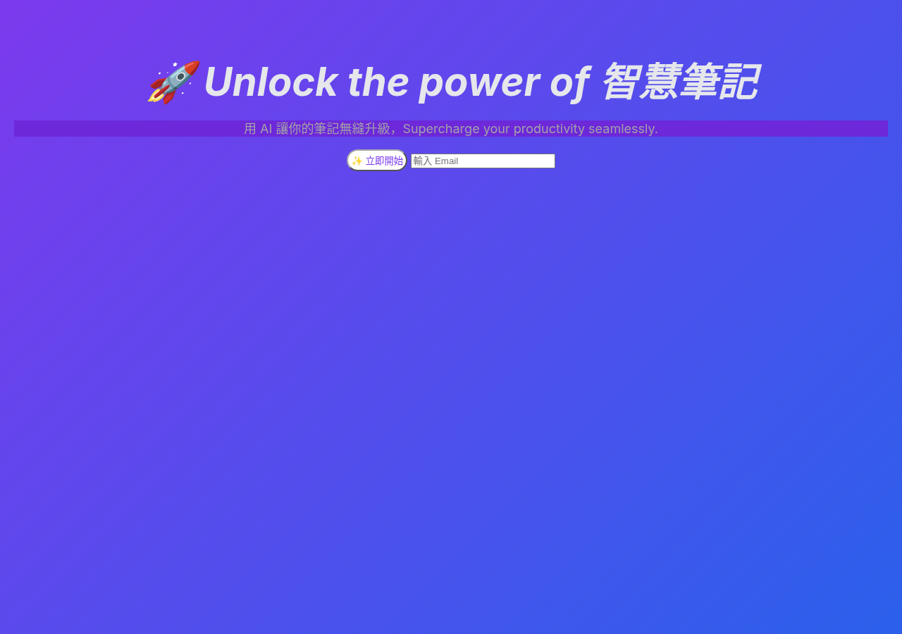
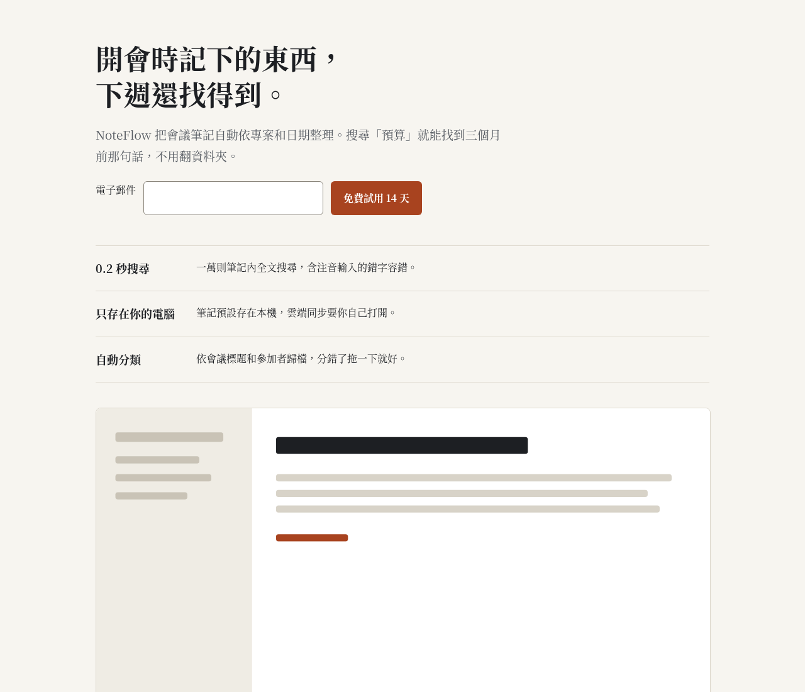
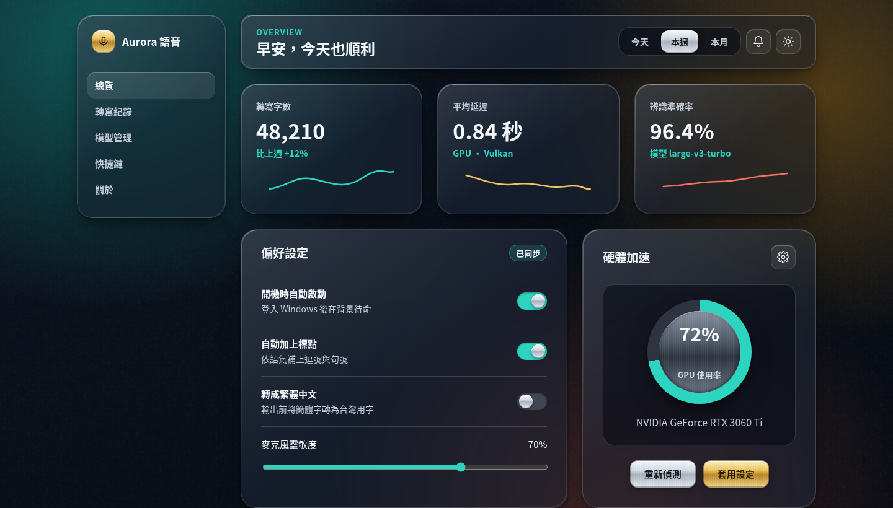
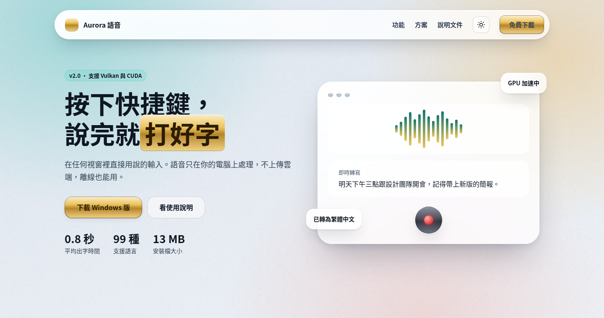
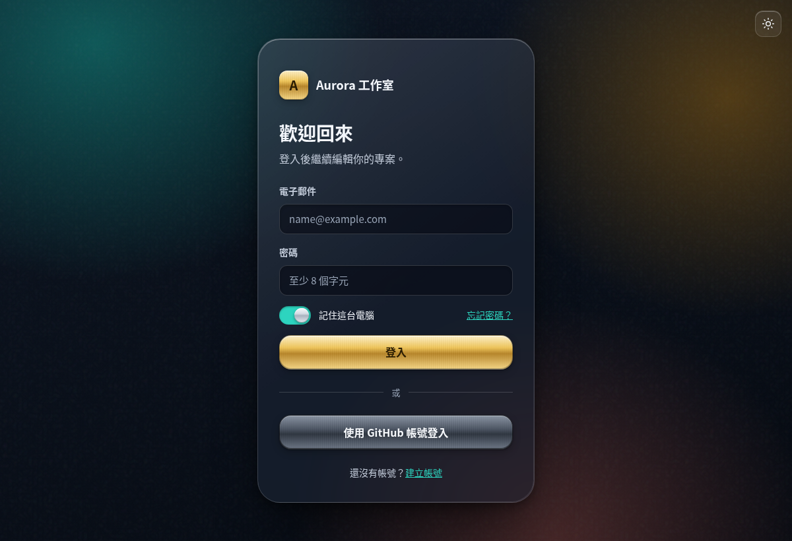
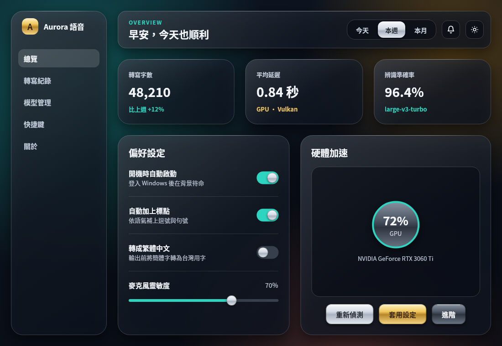

# design-sense

[繁體中文](README.md) · [](https://github.com/stevenke1981/design-sense/actions/workflows/ci.yml)

A **design vocabulary and local UI linter for coding agents** (Claude Code, Cursor, Codex, Copilot, Gemini). It covers web UI, Slint desktop apps, Windows apps and social-media graphics, with first-class Traditional Chinese (zh-TW/CJK) typography.

- **Skill:** 19 named design commands (critique, polish, typeset, …). Each one has when to use it, steps, a checklist and do/don't lists. Five platform guides cover web, Slint, Windows, social graphics and zh-TW typography.
- **Linter:** `design-sense check` has 46 deterministic rules and needs no LLM, no network and no dependencies, only Node ≥ 18. It catches generated-UI tells such as violet→blue gradients, emoji icons and nested cards. It also checks WCAG contrast, focus styles, CJK italics and missing CJK fonts.
- **Automatic use:** a Claude Code plugin with a post-edit hook, plus a Cursor rule and AGENTS.md / Copilot / GEMINI.md snippets. Agents pick it up whenever they touch UI files.

## Demo

| Before (`docs/demo/sloppy.html`, 25 findings) | After (`docs/demo/clean.html`, 0) |
|---|---|
|  |  |

Full outputs for HTML and Slint samples are in `docs/demo/*.txt` and `docs/demo/demo-report.json`.

## Premium templates (glass + metal)

`templates/premium/` holds ready-to-adapt templates: frosted-glass panels, brushed-metal buttons (silver, gold, titanium), generous radii and layered soft shadows, in dark and light, all passing `design-sense check` with 0 findings. The recipes are in [`reference/premium-glass-metal.md`](skills/design-sense/reference/premium-glass-metal.md), which agents load for "premium / glass / metal" requests.

| Dashboard (dark) | Landing (light) |
|---|---|
|  |  |
| **Login card (dark)** | **Slint settings window (dark)** |
|  |  |

- **Web:** `web/dashboard.html`, `web/landing.html`, `web/login.html`, sharing `glass.css` (tokens) and `theme.js` (dark/light, or `?theme=light`). No external dependencies.
- **Slint:** `slint/tokens.slint`, `slint/components.slint` (GlassPanel, MetalButton, GlassToggle, GlassSlider, GlassTabs, IconButton with tooltip) and `slint/demo.slint`. Slint has no backdrop blur, so glass is emulated with a translucent tint, a sheen gradient, a bright rim and shadows. Screenshots were rendered with Skia on Linux; see [slint/README.md](templates/premium/slint/README.md).
- **Social:** `social/post.svg` (1080×1080), [preview](docs/images/premium/social-post.png).

Regenerate web screenshots with `scripts/shoot-premium.sh` (needs Chrome).

## Install

Get the release zip (verify it with `SHA256SUMS.txt`) or `git clone`. Then run:
```bash
node /path/to/design-sense/install.mjs <project> --dry-run   # show the plan
node /path/to/design-sense/install.mjs <project>             # asks before copying
# parts: --only core,claude,claude-hook,cursor,agents,copilot,gemini ; --global also copies the skill to ~/.claude/skills
```

| Agent | Files | How it triggers |
|---|---|---|
| Claude Code | `.claude/skills/design-sense/`, PostToolUse hook in `.claude/settings.json` | The skill triggers from its description. After each Write/Edit of a UI file, the hook adds the findings to Claude's context. It also works as a plugin: `/plugin marketplace add stevenke1981/design-sense` |
| Cursor | `.cursor/rules/design-sense.mdc` (glob-scoped) | Auto-attached for html/css/tsx/vue/svelte/slint/svg |
| Codex / AGENTS.md tools | marked block in `AGENTS.md` | Read every task |
| GitHub Copilot | `.github/copilot-instructions.md` | Read every task |
| Gemini CLI | `GEMINI.md` | Read every task |

CI:
```yaml
- uses: stevenke1981/design-sense@v0.1.0
  with: { paths: "src ui", fail-on: P1 }
```

## Commands
shape · init · document · extract · critique · audit · polish · bolder · quieter · distill · typeset · colorize · layout · animate · harden · clarify · adapt · optimize · onboard. See `skills/design-sense/SKILL.md` and `skills/design-sense/reference/`. Templates for PRODUCT.md and DESIGN.md are in `skills/design-sense/templates/`.

## Rules (46)
Severity: **P0** broken · **P1** must fix · **P2** should fix · **P3** taste.

| ID | Sev | Applies to | Rule |
|---|---|---|---|
| `slop/inter-only` | P3 | html, css, jsx, vue, svelte | Inter (or system-ui) is the only typeface |
| `slop/purple-blue-gradient` | P2 | html, css, jsx, vue, svelte, slint | Purple→blue / violet→pink gradient |
| `slop/gradient-text` | P3 | html, css, jsx, vue, svelte | Gradient-filled headline text |
| `slop/nested-cards` | P2 | html, jsx, vue, svelte | Card inside a card |
| `slop/icon-tile-heading` | P3 | html, jsx, vue, svelte | Icon tile above every heading |
| `slop/pill-overuse` | P3 | html, css, jsx, vue, svelte | Pill shapes everywhere |
| `slop/emoji-icons` | P2 | html, css, jsx, vue, svelte, slint | Emoji used as UI icons |
| `slop/glass-everywhere` | P3 | html, css, jsx, vue, svelte | Frosted glass on many surfaces |
| `slop/hype-copy` | P3 | html, css, jsx, vue, svelte, slint | Hype marketing filler |
| `slop/side-stripe` | P3 | html, css, jsx, vue, svelte | Thick colored left border as decoration |
| `slop/center-everything` | P3 | html, css, jsx, vue, svelte | Almost everything is centered |
| `a11y/contrast` | P1 | html, css, jsx, vue, svelte, slint | Text contrast below WCAG AA |
| `a11y/gray-on-color` | P2 | html, css, jsx, vue, svelte, slint | Gray text on a saturated background |
| `color/too-many` | P3 | html, css, jsx, vue, svelte, slint | Too many one-off colors |
| `type/tiny-font` | P2 | html, css, jsx, vue, svelte, slint | Font size below 12px |
| `type/tight-line-height` | P3 | html, css, jsx, vue, svelte | Body line-height under 1.3 |
| `cjk/italic` | P1 | html, css, jsx, vue, svelte, slint | Italic applied to CJK text |
| `cjk/line-height` | P2 | html, css, jsx, vue, svelte | CJK body line-height under 1.5 |
| `cjk/missing-font` | P2 | html, css, jsx, vue, svelte, slint | CJK text with no CJK font in the stack |
| `cjk/negative-tracking` | P3 | html, css, jsx, vue, svelte | Negative letter-spacing on CJK |
| `cjk/break-all` | P3 | html, css, jsx, vue, svelte | word-break: break-all |
| `html/lang-missing` | P2 | html | <html> without lang |
| `a11y/img-alt` | P1 | html, jsx, vue, svelte | Image without alt |
| `a11y/input-label` | P1 | html, jsx, vue, svelte | Form control without a label |
| `a11y/button-name` | P1 | html, jsx, vue, svelte | Icon-only button without accessible name |
| `a11y/heading-skip` | P2 | html, jsx, vue, svelte | Skipped heading level |
| `a11y/focus-removed` | P1 | html, css, jsx, vue, svelte | Focus outline removed without replacement |
| `a11y/reduced-motion` | P2 | html, css, jsx, vue, svelte | Animation without prefers-reduced-motion |
| `a11y/click-div` | P2 | html, jsx, vue, svelte | Clickable div/span without role |
| `a11y/empty-link` | P3 | html, jsx, vue, svelte | Link with no href or href="#" |
| `a11y/zoom-disabled` | P1 | html, jsx, vue, svelte | Pinch-zoom disabled |
| `a11y/positive-tabindex` | P2 | html, jsx, vue, svelte | Positive tabindex |
| `layout/cramped-button` | P3 | html, css, jsx, vue, svelte | Button padding ≤4px |
| `layout/fixed-width` | P2 | html, css, jsx, vue, svelte | Large fixed pixel width |
| `layout/viewport-missing` | P2 | html | No responsive viewport meta |
| `layout/100vh` | P3 | html, css, jsx, vue, svelte | height: 100vh |
| `layout/z-index-war` | P3 | html, css, jsx, vue, svelte | z-index ≥ 9999 |
| `css/important-overuse` | P3 | html, css, jsx, vue, svelte | Many !important |
| `perf/img-dimensions` | P3 | html, jsx, vue, svelte | Image without width/height |
| `perf/transition-all` | P3 | html, css, jsx, vue, svelte | transition: all |
| `slint/hardcoded-colors` | P3 | slint | Color literals outside a palette global |
| `slint/window-min-size` | P2 | slint | Window without min-width/min-height |
| `slint/icon-button-tooltip` | P2 | slint | Icon-only button without tooltip/name |
| `slint/default-font` | P2 | slint | Window without default-font-family (CJK app) |
| `slint/touch-area-a11y` | P3 | slint | Custom clickable without accessible-role |
| `svg/no-viewbox` | P3 | svg | SVG without viewBox |

**Config:** `.design-sense.json` → `{ "rules": { "<id>": "off" | "P0".."P3" }, "ignore": ["glob"] }`, plus an optional `.design-senseignore`.
**Inline:** `design-sense-disable-next-line <rule>`, `design-sense-disable-line`, `design-sense-disable <rule>`, `design-sense-ignore-file`.
**Exit codes:** 0 = nothing at or above `--fail-on` (default P1), 1 = findings, 2 = usage or IO error. Use `--json` for machine output.

## Dogfooding
On four real Slint projects (speaktype, pixel-studio, Downloader, Archiver), the tuned rules report 33 findings. The first version produced 13 false positives, all fixed:
- 2 contrast reports against 1px ruler ticks.
- 3 font reports where the font was passed in as a property.
- 1 minimum-size report on a frameless popup.
- 4 reports treating the ⚠ text symbol as an emoji.
- 2 button-name reports on `data-i18n` buttons.
- 1 report on a custom IconButton that already had a tooltip, found in the demo file.

Slint's tiny-font threshold is also now < 11px, since dense desktop toolbars use 11px.

I reviewed the remaining 33 by hand and all are real issues: 9–10px text, contrast below 4.5:1, unlabeled inputs, custom clickables without an accessible-role, and windows with no CJK font set. Some are deliberate design trade-offs, such as small ruler numbers. These numbers only describe these four projects, not a general false-positive rate.

## Safety
- The linter and hook are read-only, make no network calls, download nothing and spawn no processes or agents.
- The hook fails open: on any error it exits 0 silently, and it times out after 5 s.
- The installer shows the plan first and has `--dry-run`. There is no `curl | bash`, and it makes no global changes without `--global`.

## Credits
The idea was inspired by [pbakaus/impeccable](https://github.com/pbakaus/impeccable) (Apache-2.0). All code, rules and text here were written from scratch.

## License
Apache-2.0. See [LICENSE](LICENSE) and [NOTICE.md](NOTICE.md).
