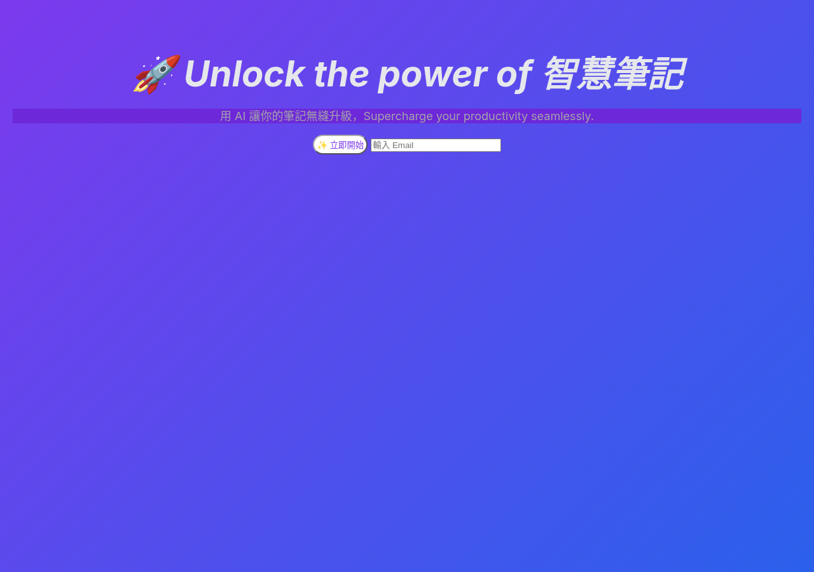
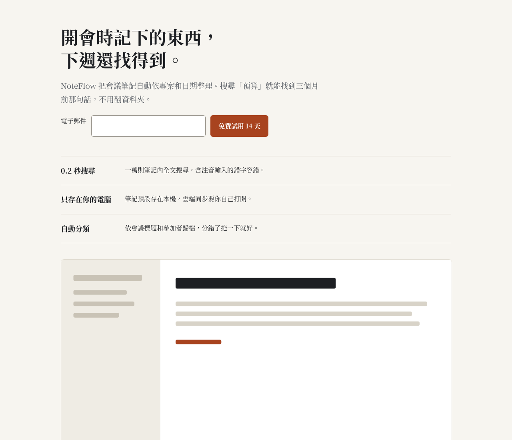

# design-sense

[English](README.en.md) · [](https://github.com/stevenke1981/design-sense/actions/workflows/ci.yml)

給程式 AI 助手（Claude Code、Cursor、Codex、Copilot、Gemini）用的**設計詞彙＋本機 UI 檢查工具**。網頁介面、Slint 桌面程式、Windows 程式、社群貼文圖片都適用，也特別照顧繁體中文排版。

- **一份 skill：** 19 個設計指令（critique、polish、typeset…），每個都有使用時機、步驟、檢查清單和該做、不該做的事。另有 Web、Slint、Windows、社群圖片、繁中排版 5 份平台指南。
- **一個檢查器：** `design-sense check`，46 條規則，不需要 AI、不連網、零相依套件，只要 Node.js 18 以上。能抓出 AI 生成介面常見的毛病，例如紫藍漸層、emoji 當圖示、卡片包卡片，也會檢查 WCAG 對比、焦點樣式、中文斜體和缺少中文字型。
- **自動使用：** Claude Code 外掛附編輯後檢查的 hook，另外也提供 Cursor 規則、AGENTS.md、Copilot、GEMINI.md 的設定片段。AI 改到 UI 檔案時會自動套用。

## 示範

| 修正前（`docs/demo/sloppy.html`，25 項問題） | 修正後（`docs/demo/clean.html`，0 項） |
|---|---|
|  |  |

```
$ design-sense check docs/demo/sloppy.slint
docs/demo/sloppy.slint
     2:2   P2 slint/window-min-size  export component MainWindow inherits Window has no min-width/min-height
     2:2   P2 slint/default-font  Window has CJK text but no default-font-family
     8:10  P2 slop/purple-blue-gradient  violet/blue gradient
     9:14  P1 cjk/italic  font-italic: true in a file with CJK text
     9:14  P2 slop/emoji-icons  emoji in text: "🚀 超快下載器"
    11:14  P2 slint/icon-button-tooltip  Button with icon and no text/tooltip
    16:14  P2 type/tiny-font  font-size: 10px
    16:14  P1 a11y/contrast  #5b5670 on #2a2540 = 2.09:1 (needs 4.5:1)
```
完整輸出在 `docs/demo/*.txt` 和 `docs/demo/demo-report.json`。

## 安裝

需要 Node.js 18 以上。先下載 [Release](https://github.com/stevenke1981/design-sense/releases) 的 zip（可用 `SHA256SUMS.txt` 驗證），或用 `git clone`，然後在你的專案執行：

```bash
node /path/to/design-sense/install.mjs <你的專案> --dry-run   # 先看會改哪些檔案
node /path/to/design-sense/install.mjs <你的專案>             # 確認後才會複製
# 只裝部分：--only core,cursor,agents   全部選項：core, claude, claude-hook, cursor, agents, copilot, gemini
```
Windows 可以用 `install.ps1`，macOS/Linux 可以用 `install.sh`，兩者都只是呼叫 `install.mjs`。安裝程式只會寫入專案資料夾，**只有加上 `--global` 才會**動到 `~/.claude`。

| AI 助手 | 安裝後會有 | 怎麼自動用到 |
|---|---|---|
| Claude Code | `.claude/skills/design-sense/`、`.claude/settings.json` 的 PostToolUse hook | skill 依描述自動觸發；每次 Write/Edit UI 檔案後，hook 會把檢查結果回饋給 Claude。也可以直接當外掛：`/plugin marketplace add stevenke1981/design-sense` |
| Cursor | `.cursor/rules/design-sense.mdc`（依副檔名套用） | 編輯 html/css/tsx/vue/svelte/slint/svg 時自動載入 |
| Codex 和其他讀 AGENTS.md 的工具 | `AGENTS.md` 中一段標記區塊 | 每次工作都會讀 |
| GitHub Copilot | `.github/copilot-instructions.md` | 每次工作都會讀 |
| Gemini CLI | `GEMINI.md` | 每次工作都會讀 |

所有工具都共用 `.design-sense/`，裡面有檢查器、hook 和 skill。重複安裝只會更新標記區塊，不會重複加入。

### 在 CI 使用
```yaml
- uses: actions/checkout@v4
- uses: stevenke1981/design-sense@v0.1.0
  with: { paths: "src ui", fail-on: P1 }
```

## 指令

| 指令 | 用途 | 指令 | 用途 |
|---|---|---|---|
| `shape` | 寫程式前先規劃畫面 | `typeset` | 字型、字級、行高、中文排版 |
| `init` | 寫 PRODUCT.md | `colorize` | 色票、對比、深色模式 |
| `document` | 從程式碼整理出 DESIGN.md | `layout` | 間距、格線、響應式 |
| `extract` | 抽出 tokens 和共用元件 | `animate` | 動態效果 |
| `critique` | 設計評論（附優先順序） | `harden` | 錯誤、空狀態、長文字、輸入法 |
| `audit` | 無障礙、響應式、效能檢查 | `clarify` | 按鈕文字、錯誤訊息、用語 |
| `polish` | 上線前最後修整 | `adapt` | 螢幕尺寸、DPI、平台 |
| `bolder` | 太平淡時加強 | `optimize` | 速度與檔案大小 |
| `quieter` | 太吵時收斂 | `onboard` | 首次使用、空狀態 |
| `distill` | 刪到只剩重點 | | |

用法：對 AI 說「用 design-sense 的 critique 看一下設定頁」或「用 design-sense polish ui/app.slint」。`skills/design-sense/templates/` 裡有 PRODUCT.md 和 DESIGN.md 範本，由 `init`、`document` 指令填寫。

## 檢查規則（46 條）

嚴重度：**P0** 壞掉、**P1** 必修（無障礙或可讀性）、**P2** 應修、**P3** 品味或建議。

| ID | Sev | Applies to | Rule |
|---|---|---|---|
| `slop/inter-only` | P3 | html, css, jsx, vue, svelte | Inter (or system-ui) is the only typeface |
| `slop/purple-blue-gradient` | P2 | html, css, jsx, vue, svelte, slint | Purple→blue / violet→pink gradient |
| `slop/gradient-text` | P3 | html, css, jsx, vue, svelte | Gradient-filled headline text |
| `slop/nested-cards` | P2 | html, jsx, vue, svelte | Card inside a card |
| `slop/icon-tile-heading` | P3 | html, jsx, vue, svelte | Icon tile above every heading |
| `slop/pill-overuse` | P3 | html, css, jsx, vue, svelte | Pill shapes everywhere |
| `slop/emoji-icons` | P2 | html, css, jsx, vue, svelte, slint | Emoji used as UI icons |
| `slop/glass-everywhere` | P3 | html, css, jsx, vue, svelte | Frosted glass on many surfaces |
| `slop/hype-copy` | P3 | html, css, jsx, vue, svelte, slint | Hype marketing filler |
| `slop/side-stripe` | P3 | html, css, jsx, vue, svelte | Thick colored left border as decoration |
| `slop/center-everything` | P3 | html, css, jsx, vue, svelte | Almost everything is centered |
| `a11y/contrast` | P1 | html, css, jsx, vue, svelte, slint | Text contrast below WCAG AA |
| `a11y/gray-on-color` | P2 | html, css, jsx, vue, svelte, slint | Gray text on a saturated background |
| `color/too-many` | P3 | html, css, jsx, vue, svelte, slint | Too many one-off colors |
| `type/tiny-font` | P2 | html, css, jsx, vue, svelte, slint | Font size below 12px |
| `type/tight-line-height` | P3 | html, css, jsx, vue, svelte | Body line-height under 1.3 |
| `cjk/italic` | P1 | html, css, jsx, vue, svelte, slint | Italic applied to CJK text |
| `cjk/line-height` | P2 | html, css, jsx, vue, svelte | CJK body line-height under 1.5 |
| `cjk/missing-font` | P2 | html, css, jsx, vue, svelte, slint | CJK text with no CJK font in the stack |
| `cjk/negative-tracking` | P3 | html, css, jsx, vue, svelte | Negative letter-spacing on CJK |
| `cjk/break-all` | P3 | html, css, jsx, vue, svelte | word-break: break-all |
| `html/lang-missing` | P2 | html | <html> without lang |
| `a11y/img-alt` | P1 | html, jsx, vue, svelte | Image without alt |
| `a11y/input-label` | P1 | html, jsx, vue, svelte | Form control without a label |
| `a11y/button-name` | P1 | html, jsx, vue, svelte | Icon-only button without accessible name |
| `a11y/heading-skip` | P2 | html, jsx, vue, svelte | Skipped heading level |
| `a11y/focus-removed` | P1 | html, css, jsx, vue, svelte | Focus outline removed without replacement |
| `a11y/reduced-motion` | P2 | html, css, jsx, vue, svelte | Animation without prefers-reduced-motion |
| `a11y/click-div` | P2 | html, jsx, vue, svelte | Clickable div/span without role |
| `a11y/empty-link` | P3 | html, jsx, vue, svelte | Link with no href or href="#" |
| `a11y/zoom-disabled` | P1 | html, jsx, vue, svelte | Pinch-zoom disabled |
| `a11y/positive-tabindex` | P2 | html, jsx, vue, svelte | Positive tabindex |
| `layout/cramped-button` | P3 | html, css, jsx, vue, svelte | Button padding ≤4px |
| `layout/fixed-width` | P2 | html, css, jsx, vue, svelte | Large fixed pixel width |
| `layout/viewport-missing` | P2 | html | No responsive viewport meta |
| `layout/100vh` | P3 | html, css, jsx, vue, svelte | height: 100vh |
| `layout/z-index-war` | P3 | html, css, jsx, vue, svelte | z-index ≥ 9999 |
| `css/important-overuse` | P3 | html, css, jsx, vue, svelte | Many !important |
| `perf/img-dimensions` | P3 | html, jsx, vue, svelte | Image without width/height |
| `perf/transition-all` | P3 | html, css, jsx, vue, svelte | transition: all |
| `slint/hardcoded-colors` | P3 | slint | Color literals outside a palette global |
| `slint/window-min-size` | P2 | slint | Window without min-width/min-height |
| `slint/icon-button-tooltip` | P2 | slint | Icon-only button without tooltip/name |
| `slint/default-font` | P2 | slint | Window without default-font-family (CJK app) |
| `slint/touch-area-a11y` | P3 | slint | Custom clickable without accessible-role |
| `svg/no-viewbox` | P3 | svg | SVG without viewBox |

`design-sense rules` 會列出所有規則，`design-sense explain <id>` 會說明原因和修法。

**設定：** 在專案根目錄放 `.design-sense.json`：`{ "rules": { "type/tiny-font": "off", "slint/hardcoded-colors": "P2" }, "ignore": ["vendor/**"] }`。也可以加 `.design-senseignore`。
**行內忽略：** `/* design-sense-disable-next-line a11y/contrast — 原因 */`、`design-sense-disable-line`、`design-sense-disable <rule>`（整個檔案），或 `design-sense-ignore-file`。
**結束代碼：** 0 表示沒有達到 `--fail-on`（預設 P1）的問題，1 表示有，2 表示參數或讀檔錯誤。加 `--json` 會輸出機器可讀的格式。

## 實測（dogfooding）

我拿自己的 4 個 Slint 專案來測（speaktype、pixel-studio、Downloader、Archiver），調整規則後共回報 33 項。前一版有 13 項誤報，已經修掉：
- 1px 刻度線被誤當成文字背景，造成 2 項對比誤報。
- `default-font-family` 用屬性傳入的字型時被誤報，共 3 項。
- 無邊框浮動視窗被要求設最小尺寸，1 項。
- 文字符號 ⚠ 被當成 emoji，共 4 項。
- 執行時才用 `data-i18n` 填文字的按鈕被誤判成沒有名稱，共 2 項。
- 另有 1 項自訂 IconButton 已經有 tooltip 卻被誤報，是在示範檔發現的。

另外，Slint 的「字太小」門檻改成小於 11px，因為桌面工具列常用 11px。

剩下的 33 項我逐一看過，都是真的問題：9–10px 的字、低於 4.5:1 的對比、沒有 label 的輸入框、沒有 accessible-role 的自訂按鈕，以及沒設中文字型的視窗。不過其中有些是設計上的取捨，例如尺規刻度數字本來就很小。這個數字只代表這幾個專案，不代表所有專案的誤報率。

## 安全

- 檢查器和 hook **只讀檔**、**不連網**、不下載任何東西、不啟動其他程式或其他 AI。
- hook 採**失敗放行**（fail-open）：輸入壞掉、找不到檔案或發生錯誤時，一律安靜地以 0 結束，最多 5 秒就逾時，不會擋住 AI 工作。
- 安裝程式會先列出變更並等你確認，有 `--dry-run`。不提供 `curl | bash` 安裝方式，也不會修改全域設定，除非你加上 `--global`。

## 致謝

這個專案的構想受到 [pbakaus/impeccable](https://github.com/pbakaus/impeccable)（Apache-2.0）啟發，但所有程式碼、規則和文字都是重新撰寫的，沒有使用該專案的內容。

## 授權

Apache-2.0，見 [LICENSE](LICENSE) 和 [NOTICE.md](NOTICE.md)。貢獻方式請見 [CONTRIBUTING.md](CONTRIBUTING.md)。
